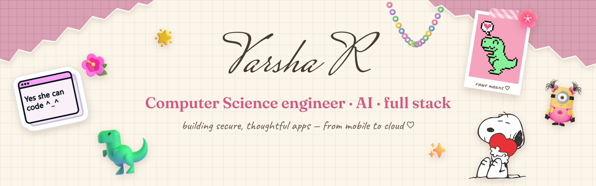
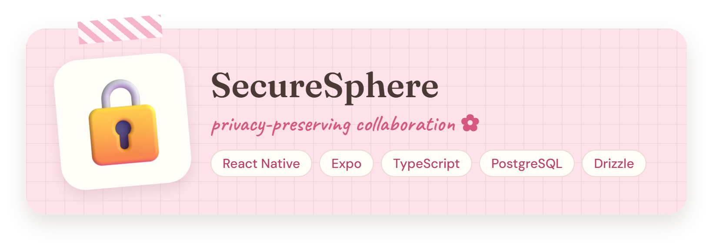
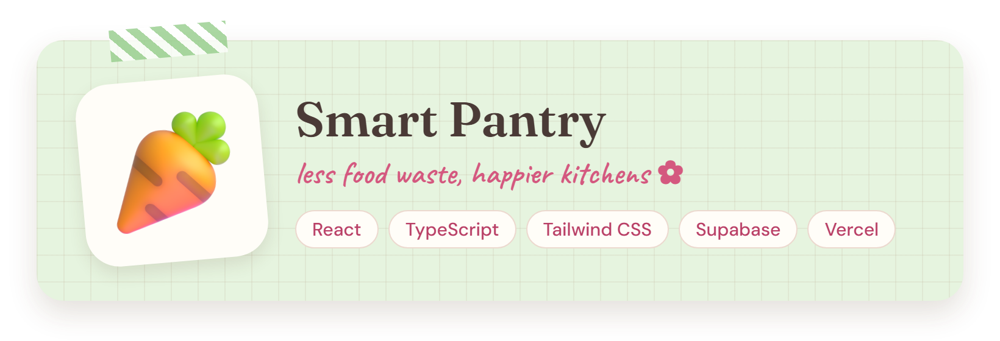
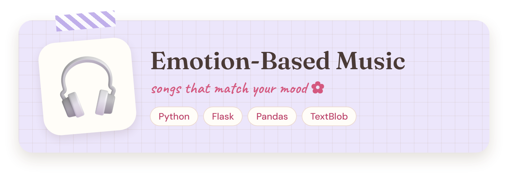

  

  

<h2>🌷 hi, i'm varsha!</h2>

- 🎓 computer science engineering student at **KSSEM, Bengaluru** (class of '27)
- 🔐 i love building apps that keep people's data safe *and* feel friendly to use
- ☁️ AWS Academy graduate — Cloud Foundations & Cloud Developing
- 🦕 powered by pixel dinos, snoopy naps & a whole lot of minion chaos

 

<h2 align="center">🧸 things i've built</h2>

<code>varsha@devspace:~$ ls ~/projects</code>

<table>
<tr>
<td width="50%" valign="top">

**Privacy-Preserving Intelligent Collaboration Platform**

End-to-end encrypted collaboration with secure file sharing, encrypted chat, searchable encryption and client-side intelligence.

</td>
<td width="50%" valign="top">

**Smart Pantry**

Grocery management platform tracking pantry inventory, expiration dates and consumption patterns to reduce household food waste.

</td>
</tr>
<tr>
<td colspan="2" valign="top" align="center">

**Emotion-Based Music Recommendation**

Detects emotional sentiment from user input and recommends music using a Python-based recommendation pipeline.

</td>
</tr>
</table>

 

<h2 align="center">🎀 my little toolbox</h2>

  
  
  
  
  
  
  
   
  
  
  
  
  
   
  
  
  
  
  
  

 

<h2 align="center">🐍 contribution garden</h2>

  

 

<h2 align="center">💌 say hi</h2>

  
  
  

   
  build • learn • create — crafted with love, dinos & bananas ♥

